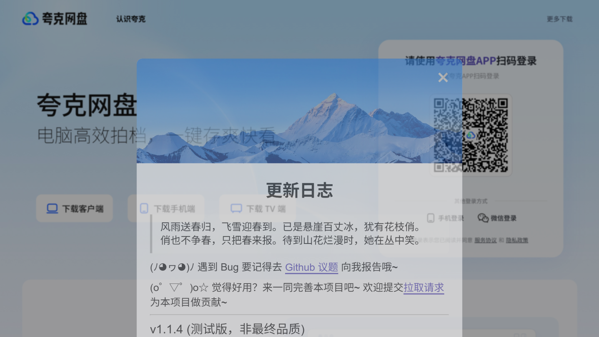

# LinkSwift for Chrome（非官方 Chrome 扩展适配）

把 [hmjz100/LinkSwift](https://github.com/hmjz100/LinkSwift) 这个油猴脚本（userscript）
适配成**原生 Chrome 扩展（Manifest V3）**，不需要安装 Tampermonkey / 暴力猴 / 脚本猫。



> ## ⚠️ 重要声明
>
> **这不是官方项目。** 上游 LinkSwift 只发布 userscript（`.user.js`），
> 仓库里没有任何 `manifest.json` 或扩展产物。本目录是对其进行**扩展化封装**的第三方适配。
>
> - 上游作者：**hmjz100**、油小猴（原作者）
> - 上游仓库：<https://github.com/hmjz100/LinkSwift>
> - 上游许可证：**AGPL-3.0-or-later**
> - 本项目沿用 **AGPL-3.0-or-later**（见 `LICENSE`）
>
> 按 AGPL 要求：如果你修改并分发本扩展，必须同样以 AGPL 开源，并提供完整源码。
> 若只是自己安装使用，不受分发条款约束。

---

## 一、安装

### 方式 A：加载已解压的扩展（开发 / 自用，推荐）

1. 打开 Chrome，地址栏输入 `chrome://extensions/`
2. 右上角打开「**开发者模式**」
3. 点击「**加载已解压的扩展程序**」
4. 选择本仓库根目录（包含 `manifest.json` 的那一层）
5. 完成。打开任一受支持的网盘网页即可看到「下载助手」按钮

### 方式 B：使用已打包的 zip

从 [Releases](../../releases) 或 `dist/` 下载 zip，解压后按方式 A 加载。

### 方式 C：自己打包

```bash
node scripts/pack.cjs
```

Chrome 出于安全策略，**默认不允许双击安装第三方 .crx**，
自用请优先用「方式 A」。


### 支持浏览器

- Google Chrome ≥ 111（需要 MV3 的 `world: "MAIN"` 内容脚本支持）
- Microsoft Edge ≥ 111（同内核，同样可用）

---

## 二、支持的网盘

百度网盘 / 阿里云盘 / 中国移动云盘 / 天翼云盘 / 迅雷云盘 / 光鸭云盘 / 夸克网盘 / UC网盘 / 123云盘

---

## 三、这个适配做了什么

上游是 userscript，运行在脚本管理器的沙箱里；扩展是原生环境，两者有本质差异。
本适配解决的核心问题如下：

### 0. 安全模型（必读）

> **postMessage 通道与页面脚本同权，这是 MAIN world 的固有限制。**
> 恶意页面脚本理论上可以伪造/嗅探 bridge 的 RPC 消息（比如让它带着用户
> Cookie 请求网盘 API）。本扩展无法在 MAIN↔ISOLATED 之间做密码学校验——
> 页面脚本能观察到并重放通道上的一切消息。
>
> **唯一的可信特权边界在 background 的 sender.origin 白名单**：
> 所有来自 content script 的消息（fetch 代理 / openTab / syncMenus）
> 都校验来源页面命中上游 @match 的 9 大网盘域名，任意其它网站的消息一律拒答。
> content_scripts 的 matches 也收敛到同样的域名清单（不再 `<all_urls>`），
> 非网盘页面完全不注入。
>
> 信任边界内的残余风险：网盘页面自身的 XSS / 第三方脚本仍可能触达本层——
> 这与 Tampermonkey 等脚本管理器的信任模型一致（脚本授权了该站点）。

### 1. `world: "MAIN"` 与 `chrome.*` 的矛盾

| 需求 | MAIN world | ISOLATED world |
|---|---|---|
| 读取页面 JS 变量（`unsafeWindow.locals` 等） | ✅ | ❌ |
| 使用 `chrome.storage` / `chrome.runtime` | ❌ | ✅ |

LinkSwift **重度依赖** `unsafeWindow`（19 处），去读百度的 `locals`、夸克的
`factStat`、迅雷的 `require("system-core:context/context.js")` 等页面内部对象。
这些只存在于 MAIN world。

但 MV3 的 `world: "MAIN"` 内容脚本**拿不到任何扩展 API**。

**方案**：双 world 架构

```
┌─────────────────────────────────────────────┐
│ MAIN world（页面上下文）                     │
│  prelude.js    → 捕获 jQuery/Swal/md5 私有引用│
│  gm-shim.js    → 提供 GM_* API 兼容层         │
│  linkswift.main.js → 上游脚本（未改逻辑）     │
└──────────────┬──────────────────────────────┘
               │ window.postMessage
┌──────────────▼──────────────────────────────┐
│ ISOLATED world（扩展上下文）                 │
│  bridge.js → 存储 / 剪贴板 / 跨域 / 资源      │
└──────────────┬──────────────────────────────┘
               │ chrome.runtime.sendMessage
┌──────────────▼──────────────────────────────┐
│ background.js → 真正发跨域 fetch 的地方      │
└─────────────────────────────────────────────┘
```

### 2. `GM_getValue` 是同步的，`chrome.storage` 是异步的

上游代码里有大量**同步**读取，例如：

```js
const storedVersion = base.getValue("setting_init").version;  // 同步！
```

而 `chrome.storage.local.get` 只能异步。

**方案**：启动前把全部存储值**预取**进一个同步 `Map`，之后：
- 读 → 直接读 `Map`（同步，符合原语义）
- 写 → 同时写 `Map` + 异步落盘（用户无感知）

### 3. 库的全局污染

很多网盘站点自带 jQuery（挂在 `window.$` / `window.jQuery`）。
扩展的 MAIN world 脚本与页面共享全局对象，直接加载 jQuery 会**互相覆盖**。

**方案**：`prelude.js` 加载后立刻 `jQuery.noConflict(true)` 把全局名让回去，
主脚本改用私有引用 `window.__linkSwiftJQuery`。

### 4. CSP 拦截 `new Function`

上游末尾有：

```js
unsafeWindow.console.clear = new Function(base.decodeBase("..."));
```

部分站点 CSP 禁止 `unsafe-eval`，这行会抛错并**中断整个脚本**。
构建时已包上 `try/catch`。

### 5. 第三方依赖全部本地化

上游通过 `@require` 从 unpkg 拉取 jQuery / SweetAlert2 / js-md5，
扩展不允许运行时注入远程脚本（MV3 CSP），因此全部下载到 `vendor/`。

---

## 四、目录结构

```
LinkSwift-Chrome/
├── manifest.json           # MV3 清单
├── LICENSE                 # AGPL-3.0（与上游一致）
├── README.md               # 本文件
├── icons/                  # 扩展图标（脚本生成）
├── vendor/                 # 本地化的第三方库
│   ├── jquery.min.js
│   ├── sweetalert2.min.js
│   ├── sweetalert2-light.min.css
│   ├── sweetalert2-dark.min.css
│   └── md5.min.js
├── src/
│   ├── prelude.js          # 捕获库私有引用（MAIN）
│   ├── gm-shim.js          # GM_* API 兼容层（MAIN）
│   ├── linkswift.main.js   # 构建产物：上游脚本（MAIN，勿手改）
│   ├── bridge.js           # world 桥接（ISOLATED）
│   └── background.js       # Service Worker
└── scripts/
    ├── build.cjs           # 构建：从上游 .user.js 生成 linkswift.main.js
    ├── fetch-vendor.cjs    # 下载第三方依赖
    ├── gen-icons.cjs       # 生成图标
    ├── verify.cjs          # 静态验证 + 端到端逻辑测试
    └── pack.cjs            # 打包 zip
```

---

## 五、构建流程

> **注意**：本仓库**已包含构建产物**（`src/linkswift.main.js`、`src/meta.js`、
> `manifest.json` 的 matches），克隆后可直接按「方式 A」加载，无需构建。
> 只有修改源码或跟进上游新版本时才需要走下面的流程。

### 首次准备

```bash
# 1. 克隆上游仓库到与本仓库【同级】的目录（目录名必须是 LinkSwift）
git clone --depth 1 --branch dev https://github.com/hmjz100/LinkSwift.git ../LinkSwift

# 2. 安装开发依赖（仅测试用）
npm i -D playwright-core

# 3. 下载第三方库（会自动给 sweetalert2 打 head 时序补丁）
node scripts/fetch-vendor.cjs

# 4. 生成图标
node scripts/gen-icons.cjs

# 5. 从上游生成主脚本 + meta + manifest
node scripts/build.cjs
```

### 更新到上游新版本

```bash
(cd ../LinkSwift && git pull)
node scripts/build.cjs
```

`build.cjs` 是 **fail-fast** 的：上游任何结构变化（元数据块、IIFE 收尾、
`new Function` 那行、`@resource` 清单）导致正则失配时**直接报错退出**，
绝不静默产出坏产物。它完成：

1. 剥离 `// ==UserScript==` 元数据块
2. jQuery 实参改私有引用；`Swal`/`md5` 全量改私有引用（防页面覆盖）
3. 给 `new Function` 加 CSP 兜底
4. 包装成 `window.__linkSwiftMain` 并在末尾主动引导启动
5. 从 `@version` / `@resource` / `@match` 生成 `src/meta.js`（单一事实来源）
6. 把 META 内联进 `src/gm-shim.js`（幂等）
7. 同步 `manifest.json` 的版本号与 matches

---

## 六、验证

```bash
node scripts/verify.cjs    # 静态验证 + vm 双 world 端到端（45 项）
node scripts/real-test.cjs # 实机验证（需先启动带扩展的 Playwright Chromium，21 项）
```

静态验证覆盖：

- manifest 合规 + **chrome.* API 权限交叉检查**（防 contextMenus 权限缺失复发）
- 版本三处一致（上游 @version === meta.js === manifest）
- 主脚本产物（Swal/md5 私有引用替换数、补丁命中、IIFE 包装）
- 真实 bridge.js 在 vm 双 world 沙箱中的存储/资源链路

实机验证覆盖（Playwright Chromium + CDP）：

- 扩展加载检查（chrome://extensions）
- **非网盘页不注入**（matches 收敛断言）
- 百度网盘（openapi.baidu.com）：GM_* 挂载、库私有引用、存储往返 + 持久化、
  同源请求、**跨域请求经 background 流式代理**、**abort() 语义**（取消后不重下）
- 夸克网盘：注入 + 无错误

> **实机测试注意**：Google 官方品牌的 Chrome ≥137 会忽略 `--load-extension`
> 开关，需用 Playwright 的 Chromium（非品牌构建）跑测试。真机安装不受影响
> （chrome://extensions 开发者模式加载）。

---

## 七、已知限制

| 限制 | 说明 |
|---|---|
| 跨域请求进度 | 走 background port 流式转发，有进度事件（100ms 节流）；但**请求头/进度事件经 postMessage 传播，页面脚本可观测**（见安全模型） |
| 无自动更新 | 不像 Tampermonkey 会检查脚本更新，升级需重新 `git pull` + `build.cjs` |
| Chrome 品牌版限制 | Chrome ≥137 的官方构建忽略 `--load-extension` 命令行开关（不影响 chrome://extensions 手动加载） |
| 部分站点 CSP | 极少数站点 CSP 极严，可能影响内联样式注入（`new Function` 已加兜底） |

---

## 八、免责声明

> 本项目所获取的下载链接均基于各大网盘服务商公开的 API 接口获取。
> **未以任何形式承诺、宣传或实现对网盘限速机制的破解。**
>
> 若实际使用中获得较快的下载速度，通常系服务商接口策略、本地网络环境
> 或阶段性带宽调整所致，**请勿误解为本项目具备破解限速的能力**。
>
> 下载速度完全取决于你自己账号的权限 —— **非会员仍会被限速**。

本项目坚持技术中立，仅为协助无法或不便使用官方客户端的用户
实现合法的文件下载需求。请遵守各网盘的服务条款。

---

## 九、致谢

- [hmjz100](https://github.com/hmjz100) —— LinkSwift 作者，主要维护者
- 油小猴 —— 原「网盘直链下载助手」作者
- 所有上游贡献者

如果这个扩展对你有用，请给**上游仓库**点个 Star：
<https://github.com/hmjz100/LinkSwift>
